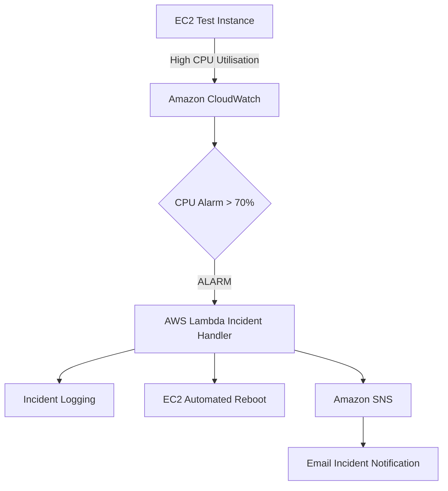

# Automated Incident Response System on AWS

## Overview

This project demonstrates an automated incident response workflow built using AWS services. It detects high CPU utilisation on an EC2 instance, triggers an incident response process using AWS Lambda, records incident details, automatically reboots the affected instance, and sends an email notification through Amazon SNS.

The workflow was tested by deliberately generating high CPU utilisation on an EC2 instance to trigger a real CloudWatch alarm and validate the automated remediation process.

## Architecture



### Incident Response Workflow

1. **Monitoring** – Amazon CloudWatch monitors EC2 CPU utilisation.
2. **Detection** – A CloudWatch alarm triggers when CPU utilisation exceeds 70%.
3. **Automation** – The alarm invokes the Lambda incident handler.
4. **Logging** – Lambda records incident details, including the alarm name, state, timestamp, reason and incident ID.
5. **Remediation** – Lambda automatically initiates an EC2 reboot.
6. **Notification** – Amazon SNS sends an incident alert by email.
7. **Recovery** – The EC2 instance returns to a running state following the reboot.

## AWS Services Used

| Service | Purpose |
|---|---|
| Amazon EC2 | Hosts the test Linux server |
| Amazon CloudWatch | Monitors CPU utilisation and detects incidents |
| AWS Lambda | Processes incidents and initiates automated remediation |
| Amazon SNS | Sends incident notifications via email |
| AWS IAM | Controls permissions for incident response actions |
| AWS Systems Manager | Provides browser-based access through Session Manager |

## Technologies

- AWS
- Python
- Boto3
- Linux
- CloudWatch Alarms
- AWS Lambda
- Amazon SNS
- IAM
- EC2
- Systems Manager Session Manager
- Serverless automation

## Monitoring Configuration

The CloudWatch alarm was configured with the following conditions:

| Configuration | Value |
|---|---|
| Metric | CPUUtilization |
| Threshold | Greater than 70% |
| Evaluation Period | 1 minute |
| Datapoints to Alarm | 1 |
| Alarm State | ALARM |

## Automated Incident Handler

The AWS Lambda function was developed in Python using Boto3.

When an incident is detected, the function:

- Extracts alarm information from the event
- Generates an incident timestamp
- Records the incident ID
- Logs the incident details
- Identifies the targeted CloudWatch alarm
- Initiates an EC2 reboot when the CPU alarm enters the ALARM state
- Sends an incident notification through Amazon SNS

## Incident Information Logged

Each incident records information including:

- Incident ID
- Timestamp
- Alarm name
- Alarm state
- Incident reason
- AWS Region
- AWS account
- Remediation status

## Security and Permissions

IAM permissions were configured to allow the Lambda function to:

- Publish incident notifications to the SNS topic
- Reboot the designated EC2 test instance

The EC2 reboot permission was restricted to the specific test instance ARN.

The project also highlighted the importance of implementing least-privilege IAM permissions rather than relying on overly broad permissions.

## Testing and Results

The incident response workflow was tested by deliberately generating CPU load on the EC2 instance.

### Test Results

- [x] CPU utilisation increased above the configured threshold
- [x] CloudWatch alarm entered the ALARM state
- [x] Lambda function was invoked
- [x] Incident details were recorded in CloudWatch Logs
- [x] EC2 reboot remediation was initiated
- [x] SNS email notification was received
- [x] EC2 instance returned to a running state

### Successful Incident Flow

```text
CPU Spike
    ↓
CloudWatch Alarm
    ↓
Lambda Invocation
    ↓
Incident Logging
    ↓
Automated EC2 Reboot
    ↓
SNS Email Notification
    ↓
Instance Recovery
```

## Screenshots

Screenshots demonstrating the completed project:

- CloudWatch alarm triggered
- Lambda incident handler logs
- SNS email incident notification
- EC2 instance after automated reboot

## Key Learning Outcomes

This project provided practical experience in:

- Building automated incident response workflows
- Monitoring AWS infrastructure
- Configuring CloudWatch alarms
- Developing Lambda functions with Python and Boto3
- Automating infrastructure remediation
- Configuring SNS notifications
- Managing IAM permissions
- Testing incident response scenarios
- Troubleshooting AWS service integrations


## Disclaimer

This project was developed and tested in a personal AWS environment for learning and portfolio purposes. Automated reboot actions should be implemented carefully in production environments with appropriate safeguards, monitoring and recovery procedures.
